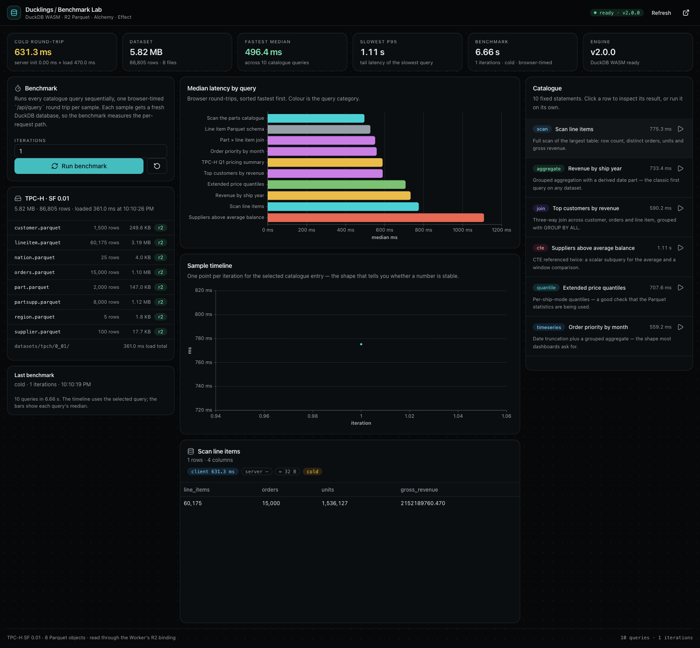

# Ducklings · Alchemy Starter

A Vite + Effect + Alchemy starter for running DuckDB WASM over R2 Parquet in a
Cloudflare Worker. The engine and web Workers are separate; `/api/*` is proxied
over a service binding.

**Stack:** Ducklings, Effect 4 (Schema, HttpClient, Atom), Vite, React 19,
Tailwind v4, shadcn, TanStack Charts, Alchemy, Bun.

```bash
cp .env.example .env
bun install
bun run deploy   # Alchemy creates R2 + both Workers
bun run seed     # upload TPC-H Parquet
bun run dev      # http://localhost:5180
```



See [docs/BENCHMARKING.md](docs/BENCHMARKING.md) for the benchmark notes.
